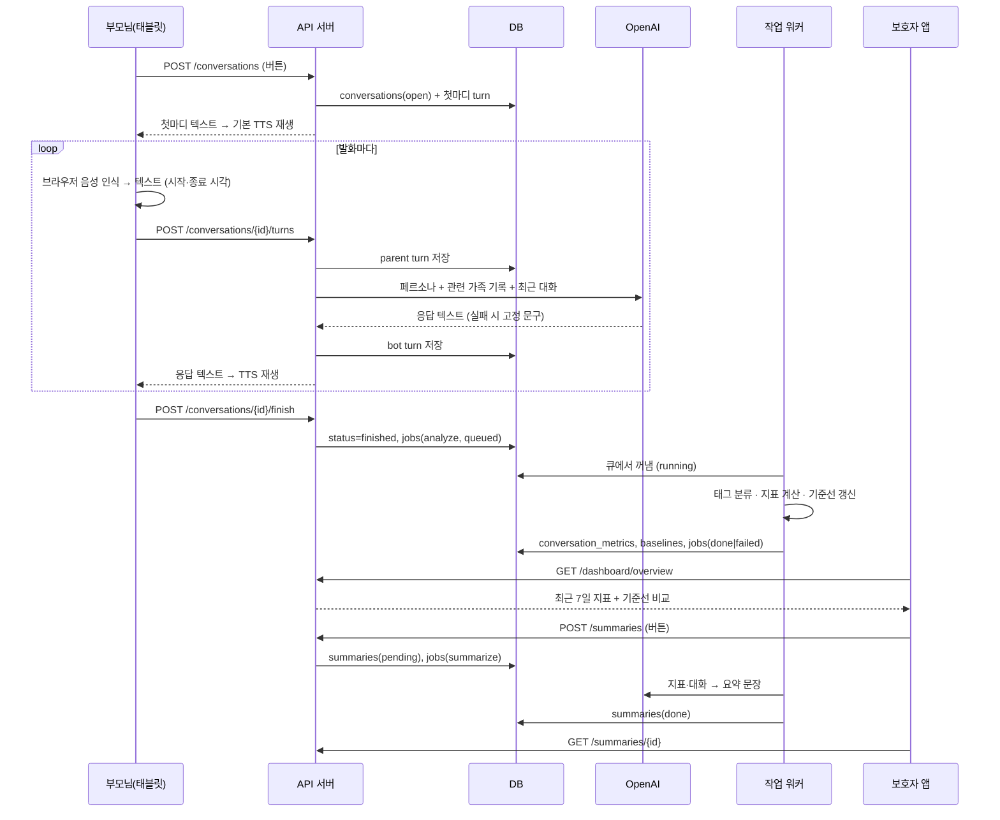
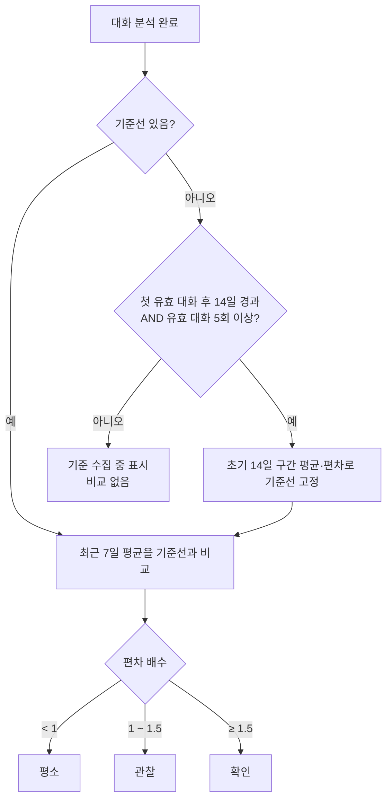
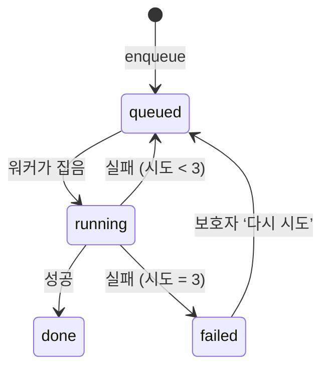

# 다정이 MVP 흐름도

## 1. 전체 구조

```mermaid
flowchart LR
  subgraph 부모님
    T[태블릿 웹<br>tablet.html]
  end
  subgraph 보호자
    G[보호자 앱<br>app.html]
  end
  subgraph 방문자
    L[랜딩페이지<br>index.html]
  end
  subgraph 서버["API 서버 1대 (FastAPI)"]
    API[/api/*]
    J[작업 워커<br>analyze · summarize]
    DB[(SQLite / PostgreSQL)]
    FS[(음성 파일<br>암호화 스토리지)]
  end
  O[OpenAI API<br>응답 생성 · STT(보조) · 요약]
  T -- 발화 텍스트·시각 --> API
  API -- 응답 텍스트 --> T
  G -- 조회·수정·요약 요청 --> API
  L -- 신청 폼 --> API
  API <--> DB
  API --> FS
  API -. 큐 .-> J
  J <--> DB
  API -- 페르소나+가족 기록 --> O
  J -- 지표·대화 --> O
```

## 2. 대화 1건의 처리 흐름 (검수 기준: 음성 입력 → DB 저장 → 분석 → 대시보드 → AI 요약)



## 3. 기준선과 비교 규칙



## 4. 작업 큐 상태


