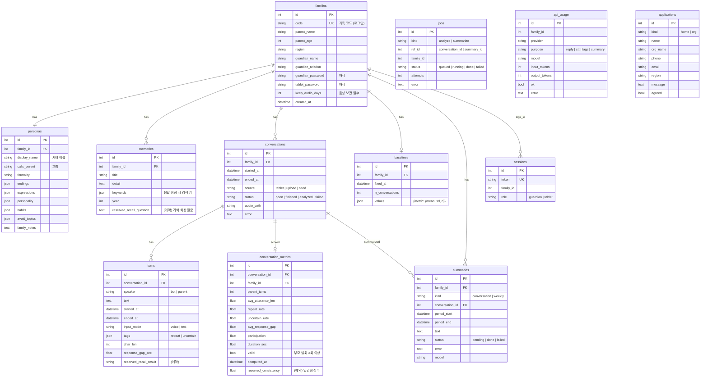

# 다정이 MVP ERD

소스: `server/app/models.py`. 기본 SQLite 파일(`server/data/dajeong.db`), `DATABASE_URL` 로 PostgreSQL 전환 가능.

## 향후 연결 위치 (이번 범위 밖, 작업지시서 §7)
| 향후 항목 | 연결 위치 |
| --- | --- |
| 기억 회상 정답률 | `memories.reserved_recall_question` 에 질문을 두고, 부모 발화에 `turns.reserved_recall_result`(ok/fail) 를 기록 → `conversation_metrics` 에 비율 컬럼 추가 |
| 일관성 점수 | `conversation_metrics.reserved_consistency` (LLM 채점) |
| 자동 알림 | `baselines` 비교 결과가 `notable` 로 2주 연속이면 새 `alerts` 테이블에 생성, 보호자 연락처로 발송 |
| 음성 감정 | `turns` 에 `emotion` 컬럼 추가, 음성 파일(`conversations.audio_path`) 기반 |
